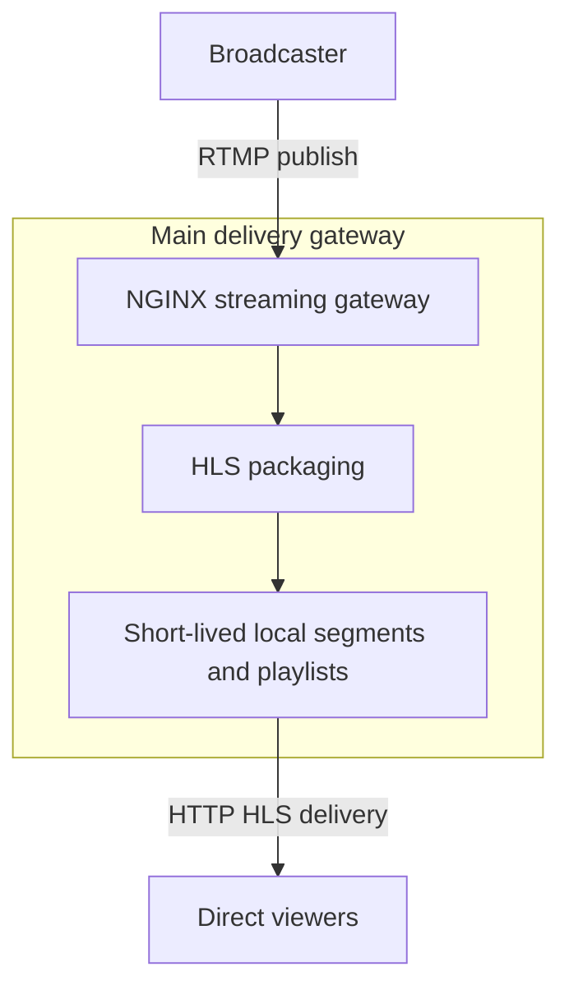
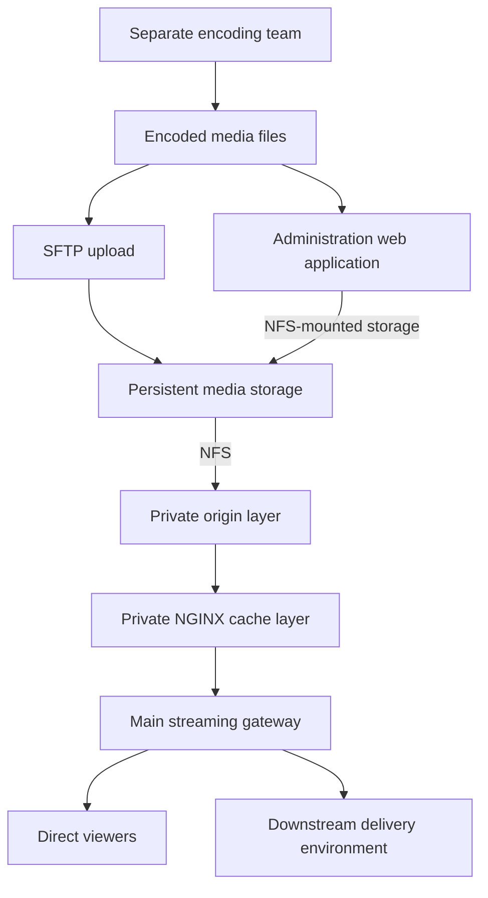
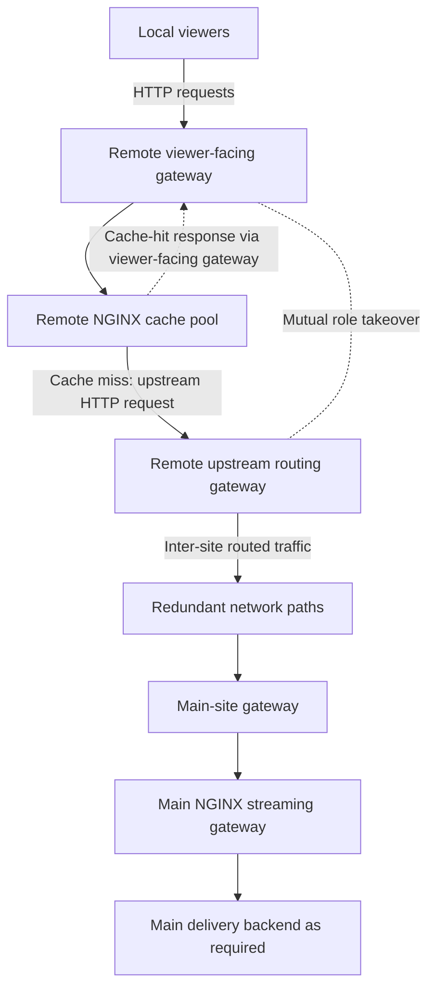

# Architecture and content flows

These are generalized logical diagrams, not physical deployment maps. Arrows are labeled by flow type; exact production routing and configurations are intentionally omitted.

## Live streaming

Live streams are packaged and served at the main gateway. Temporary HLS files are stored locally; long-term live archiving is outside this design.

## VOD content lifecycle

Arrows in this diagram indicate content movement, not HTTP request direction. Media encoding is external to the delivery infrastructure. The administration application and SFTP service are externally reachable as required; the main cache and origin layers remain private.

## Distributed CDN request routing

The remote NGINX cache uses the main NGINX streaming gateway as its upstream HTTP endpoint. The intervening remote gateway forwards network traffic; it is not assumed to be an additional HTTP proxy. Cache-hit responses travel back through the viewer-facing gateway to viewers. Some downstream environments also host their own content; their exact local routing is outside this overview.

## Routing boundary

OSPF operates in a single area among participating remote routing nodes and the main-site router. Main-site servers use static default routes to their gateway. Local main-site cache and origin traffic does not require inter-site dynamic routing.
