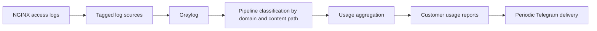
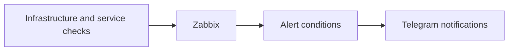

# Monitoring and usage reporting

## Usage reporting

Graylog is used to generate content-level usage reports, including viewer-related metrics and transferred data volumes, grouped by domain and URL subdirectory. These reports support customer charging decisions; the system does not itself perform billing or payment processing. The viewer identity method and byte-counting accuracy are not independently validated here.

## Monitoring

Zabbix monitors physical servers, availability, CPU, memory, disk, network utilization, physical link status, services and URLs. Telegram is used to deliver operational notifications.

Actual customer logs, addresses, access tokens, notification destinations and operational thresholds are intentionally excluded.
